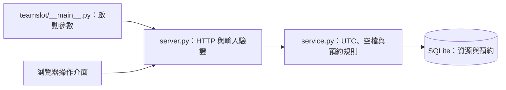

# TeamSlot｜團隊共用資源與時段預約系統

> 以同一筆交易處理時段檢查與預約，避免共用資源重複占用。

## 系統簡介

TeamSlot 是供會議室、錄音設備等共用資源使用的本機預約展示系統。使用者可新增資源、建立預約、查看已有行程與連續空檔，並使用建立時取得的取消憑證釋放時段。

本版為 v0.1 本機展示版，使用 AI 協作實作，沒有正式團隊上線或真實使用者的聲明。

## 使用情境與開發動機

- 把散落在聊天訊息或人工表格中的預約，集中為可查詢的資源行程。
- 處理多人同時送出同一資源、同一時段時的衝突。
- 一致處理時區與相鄰時段，避免只用畫面字串比對時間。

## 核心功能

| 功能 | 說明 |
| --- | --- |
| 資源管理 | 新增與列出共用資源，檢查名稱重複。 |
| 時段預約 | 檢查同一資源的時間重疊，衝突回覆 409。 |
| 跨時區輸入 | 接受帶時區的時間，正規化為 UTC。 |
| 行程與空檔 | 查詢區間內有效預約，以及符合最短長度的連續可用區間。 |
| 憑證取消 | 以隨機取消憑證取消單筆預約；資料庫只保存摘要。 |
| 操作介面 | 繁體中文網頁、表單驗證與衝突提示。 |

## 技術選型

| 層次 | 技術 | 用途 |
| --- | --- | --- |
| 執行環境 | Python 3.11 以上 | 標準函式庫即可啟動，無第三方執行依賴。 |
| HTTP | Python 標準 HTTP server | 本機 API 與靜態介面，非正式對外伺服器。 |
| 資料庫 | SQLite | 預約保存、交易、防重疊與查詢。 |
| 前端 | HTML、CSS、原生 JavaScript | 資源與預約操作介面。 |
| 驗證 | unittest、GitHub Actions | 服務層、真實 HTTP、持久化與併發測試。 |

## 系統架構



上圖依現有模組呈現 HTTP、領域規則與資料存取的關係；各項規則與執行邊界見後續章節。

## 工程設計重點

| 設計面向 | 實作方式 |
| --- | --- |
| 交易式衝突檢查 | BEGIN IMMEDIATE 在檢查前取得寫入保留鎖，並在同一交易建立預約。 |
| 半開時間區間 | 使用 [start, end)，允許上一筆結束時間等於下一筆開始時間。 |
| 取消權限最小化 | 取消憑證只授權該筆預約的取消，不冒充完整帳號認證。 |
| 可重現的併發驗證 | 以多個請求競爭相同時段，檢查只能有一筆成功。 |

## 功能實作細節

- 新增、查詢共用資源；資源名稱去除頭尾空白並避免 ASCII 大小寫重複。
- 建立預約、檢查重疊、回傳清楚的 `409 booking_conflict`。
- 使用半開區間 `[start, end)`：10:00–11:00 與 11:00–12:00 可以相鄰。
- 支援帶時區的 ISO 8601 輸入，統一正規化為 UTC，保留微秒精度。
- 查詢一段期間的預約，以及符合最短長度的連續可用區間。
- 憑隨機取消憑證取消預約；資料庫只保存 SHA-256 摘要，重複取消回傳相同狀態。
- 繁體中文操作介面、響應式排版、表單驗證、建立後顯示取消憑證。
- 服務層、真實 HTTP、資料持久化與八個併發預約請求的自動測試。
- GitHub Actions 設定：Windows / Linux × Python 3.11 / 3.12 / 3.13。

## 快速啟動

需求：**Python 3.11 以上**。從本專案根目錄執行，不需要安裝套件。

```bash
python -m teamslot
```

Windows 若 `python` 沒有指向正確版本，可改用 `py -3 -m teamslot`。

開啟 <http://127.0.0.1:8000>，新增「會議室 A」，即可建立預約。預設資料庫放在 `data/teamslot.db`，啟動時自動建立；資料庫與執行產物已排除於 Git。

自訂連接埠及資料庫位置：

```bash
python -m teamslot --port 8080 --database data/demo.db
```

用 `Ctrl+C` 結束程式。刪除自己的本機資料庫前請先停止服務並自行備份；重新啟動不會自動重設資料。

## 測試

```bash
python -m unittest discover -s tests -v
```

測試使用獨立暫存資料庫，HTTP 測試使用作業系統分配的本機連接埠，不會改動示範資料庫。CI 工作流程已提供；本機通過結果與 GitHub Actions 實際結果是兩回事，請以各次執行記錄為準。

## 操作示範

1. 新增「會議室 A」與「錄音設備」。
2. 在同一資源建立 10:00–11:00 的預約。
3. 再建 10:30–11:30 的預約，畫面會顯示時段衝突。
4. 建立 11:00–12:00 的預約，確認相鄰時段可以共存。
5. 保存建立時出現的預約編號與取消憑證，然後取消預約。
6. 再次預約剛釋出的時段，並重新啟動確認資料仍存在。

## API 一覽

| 方法 | 路徑 | 用途 |
| --- | --- | --- |
| GET | `/api/health` | 健康檢查與版本 |
| GET / POST | `/api/resources` | 查詢 / 新增資源 |
| POST | `/api/bookings` | 建立預約 |
| GET | `/api/bookings?resource_id=…&start=…&end=…` | 查詢有效預約 |
| GET | `/api/availability?resource_id=…&start=…&end=…&duration_minutes=30` | 查詢連續空檔 |
| POST | `/api/bookings/{id}/cancel` | 使用取消憑證取消 |

完整請求、回應及錯誤碼見 [API 文件](docs/API.md)。

## 專案結構

```text
teamslot/
  __main__.py           啟動參數與本機伺服器
  service.py            排程規則、UTC 正規化、SQLite 交易
  server.py             HTTP 路由、輸入驗證、JSON 錯誤
  static/               HTML、CSS、原生 JavaScript
tests/
  test_service.py       規則、持久化、取消權限、併發
  test_http.py          真實 HTTP 與完整預約流程
docs/
  API.md                API 契約與範例
  ARCHITECTURE.md       架構、取捨與後續方向
.github/workflows/      自動測試設定
```

## 時間區間與交易細節

重疊條件為 `existing.start < new.end AND existing.end > new.start`。`BEGIN IMMEDIATE` 在檢查前取得 SQLite 寫入保留鎖，其他寫入請求會等待這個交易完成，再重新檢查衝突。這適合本機、小型部署的單一 SQLite 資料庫，代價是寫入序列化；並非高吞吐分散式排程解法。

SQLite 開啟 WAL 與外鍵約束，並為有效預約建立部分索引。所有查詢使用參數綁定。取消憑證只在建立回應中出現；一般查詢不含憑證或摘要。前端只將憑證放在目前頁面的記憶體中，重新整理後需使用保存的憑證取消。

## 目前限制與後續方向

此版本預設只綁定 `127.0.0.1`。內建 HTTP server 適合本機作品展示，**請勿直接對外開放或填入真實個人資料**。新增資源與檢視行程尚無帳號權限控管；取消憑證僅授權取消那一筆預約，並非完整身分驗證系統。

已知限制：沒有帳號 / 團隊隔離、HTTPS、速率限制、分頁、重複預約、通知、資料庫升級遷移與正式部署組態；重試建立預約不具 idempotency key 保證；可用時段回傳連續區間，不會自動切成固定長度候選時段。SQLite 的內建 `NOCASE` 主要處理 ASCII 大小寫，並非完整 Unicode 名稱正規化。

下一步可由使用者實作：補上登入與資源管理權限、PostgreSQL 時間區間排他約束、整合日曆或 iCalendar 匯出，並加入瀏覽器端自動測試。架構與面試討論題見 [設計文件](docs/ARCHITECTURE.md)。
