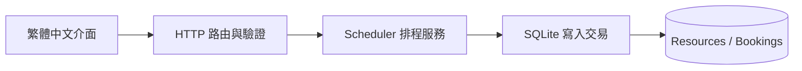

# 架構、取捨與實作說明

## 資料流

`server.py` 處理 HTTP、JSON、欄位集合和錯誤碼；`service.py` 負責時間正規化、預約規則與資料庫。服務層不依賴 HTTP，測試能直接呼叫規則。HTTP 整合測試則真正啟動本機伺服器，透過標準 HTTP client 驗證端到端流程。

## 為什麼保留 SQLite 與標準函式庫？

目標是讓面試官或使用者複製檔案後即可啟動與測試，集中展示交易、資料結構、邊界條件及可驗證的工程決策。專案並不以框架整合或雲端規模作為已完成成果。正式對外服務時，應改用適當的應用伺服器、身分驗證、授權、HTTPS、速率限制與營運監控。

## 衝突與併發

1. 建立新的資料庫連線並執行 `BEGIN IMMEDIATE`。
2. 確認資源存在。
3. 查詢有效預約是否滿足 `start < requested_end AND end > requested_start`。
4. 若有衝突回滾並回傳 `409`；沒有則寫入新預約並提交。

這讓本服務中所有遵守此交易流程的寫入序列化。其他寫入會等前一筆交易完成，避免「兩個請求都先讀到沒有衝突」的競爭條件。WAL 可改善讀寫共存，但不會允許多個同時寫入的交易。預設等待鎖定上限 10 秒，資料庫暫時無法取得時回傳 `503`。

限制：沒有在資料庫層建立時間重疊排他約束；外部程式若直接寫入資料庫、繞過服務層，仍可能製造衝突。擴充到 PostgreSQL 時可探索 range 型別與 exclusion constraint。這項擴充尚未實作。

## 時間

輸入必須含時區，不接受 naive datetime。儲存前正規化成 UTC，固定為 `YYYY-MM-DDTHH:MM:SS.ffffffZ`，讓 SQLite 文字比較可用於時間排序。採半開區間，因此完全相鄰的預約不衝突。前端使用瀏覽器時區顯示；每日查詢以本機午夜計算下一天，可容納日光節約時間造成的 23 / 25 小時日期。

系統使用時間偏移而非持久保存 IANA 時區；尚不支援固定某地牆上時間的週期性預約。過去日期允許預約，以方便固定測試資料。單筆最長 8 小時，查詢範圍最多 31 天。

## 取消憑證

每次建立產生 32 bytes 隨機資料的 URL-safe 憑證。取消時驗證 SHA-256 摘要並採固定時間比較。憑證透過 Authorization header 傳送，避免出現在 URL 與一般查詢記錄中。前端記憶體不會在重新整理後保留憑證，使用者需自行保存建立回應。

憑證是 bearer capability：取得憑證的人可取消對應預約，因此仍需 HTTPS 才適合跨網路傳送。此設計不包含完整登入、權限或憑證找回流程。

## 測試策略

- 規則：不同重疊形狀、相鄰時段、不同資源、UTC 偏移與微秒。
- 輸入：空字串、錯誤型別、缺少時區、超長時段及查詢範圍。
- 權限：取消憑證必須吻合、查詢不可洩漏 token 或 digest。
- 持久化：重新建立服務物件後，資料仍可查詢。
- 併發：8 個獨立服務物件及連線同時預約，斷言 1 筆成功、7 筆衝突。
- HTTP：建立資源→預約→衝突→查詢空檔→取消→再次預約；錯誤格式與靜態路徑限制。

自動測試尚未涵蓋瀏覽器互動、正式負載、惡意網路流量或跨主機部署。GitHub Actions 矩陣是預先提供的工作流程，不代表這些環境已實際執行完成。

## 面試前建議自己驗證

1. 取消 `BEGIN IMMEDIATE` 後，如何設計實驗重現競爭條件？
2. 為什麼區間重疊不能只檢查開始時間？
3. 如果要求「每週一台北時間 10:00」，只存 UTC 是否足夠？
4. 查詢可用時段後到送出預約之間，資源可能被別人預約，介面應如何處理？
5. 要加入帳號及組織，哪些端點和資料表需要新的授權檢查？

只在能自己說明、修改並重現測試的範圍內描述個人貢獻。不要把範例測試數量、尚未執行的 CI 或規劃中的功能改寫成上線成效。
